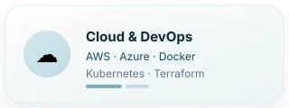

<div align="center">

  <!-- Computer Header — auto light/dark via prefers-color-scheme -->
  <picture>
    <source media="(prefers-color-scheme: dark)" srcset="./assets/computer_header_dark.svg" />
    <source media="(prefers-color-scheme: light)" srcset="./assets/computer_header.svg" />
    
  </picture>

  <br/><br/>

  <!-- Animated Typing Subtitle -->
  <a href="https://git.io/typing-svg">
    
  </a>

  <br/><br/>

  <!-- Quick Badges -->
  <a href="https://www.linkedin.com/in/heloisa-pgarcia" target="_blank">
    
  </a>
  <a href="mailto:heloisa.design.99freelas@gmail.com">
    
  </a>
  
  

</div>

<br/>

---

## ⚡ `whoami`

```bash
$ whoami --verbose
> Name: Heloisa Pe Garcia
> Location: São Paulo, SP - Brazil 🇧🇷
> Role: Software Developer | DevOps & Cloud Architect | AI Enthusiast
> Status: 🚀 Building resilient cloud infrastructure & intelligent software solutions
> Philosophy: "Transforming complex engineering challenges into scalable, elegant systems."
```

<br/>

<!-- Visual Domain Cards — each with its own signature micro-animation & auto light/dark -->
<div align="center">
  <table border="0" width="100%">
    <tr align="center">
      <td width="33%">
        <picture>
          <source media="(prefers-color-scheme: dark)" srcset="./assets/card_devops_dark.svg" />
          <source media="(prefers-color-scheme: light)" srcset="./assets/card_devops.svg" />
          
        </picture>
      </td>
      <td width="33%">
        <picture>
          <source media="(prefers-color-scheme: dark)" srcset="./assets/card_ai_dark.svg" />
          <source media="(prefers-color-scheme: light)" srcset="./assets/card_ai.svg" />
          
        </picture>
      </td>
      <td width="33%">
        <picture>
          <source media="(prefers-color-scheme: dark)" srcset="./assets/card_maker_dark.svg" />
          <source media="(prefers-color-scheme: light)" srcset="./assets/card_maker.svg" />
          
        </picture>
      </td>
    </tr>
  </table>
</div>

<br/>

<table align="center" width="100%">
  <tr>
    <td width="50%" valign="top">
      <h3>🚀 Core Pillars</h3>
      <ul>
        <li>⚡ <b>DevOps & Infrastructure:</b> CI/CD pipelines, containerization, automation & GitOps practices.</li>
        <li>☁️ <b>Cloud Architecture:</b> Designing scalable AWS & Azure environments with Terraform IaC.</li>
        <li>🤖 <b>Artificial Intelligence:</b> Machine learning algorithms, Python, and data integration.</li>
        <li>🖨️ <b>Physical Computing & Maker:</b> 3D CAD modeling, 3D printing & hardware prototyping.</li>
      </ul>
    </td>
    <td width="50%" valign="top">
      <h3>🌱 Current Focus & Journey</h3>
      <ul>
        <li>📦 Advanced orchestration with <b>Kubernetes</b> & Service Meshes.</li>
        <li>🔄 Building automated <b>GitOps & MLOps</b> workflows.</li>
        <li>🧠 Exploring AI Agents, LLM integration & autonomous systems.</li>
        <li>💡 Continuously building, experimenting & contributing to open source.</li>
      </ul>
    </td>
  </tr>
</table>

<br/>

---

## 🛠️ Tech Stack & Ecosystem

<div align="center">

  <h3>💻 Languages & Core Web</h3>
  <a href="https://skillicons.dev">
    
  </a>

  <br/><br/>

  <h3>☁️ Cloud, DevOps & Infrastructure</h3>
  <a href="https://skillicons.dev">
    
  </a>

  <br/><br/>

  <h3>🛢️ Databases, AI & Development Tools</h3>
  <a href="https://skillicons.dev">
    
  </a>

</div>

<br/>

<!--
  🚧 Featured Projects — ready to wire up, just needs real repo names.
  Tell me which 2–4 repos to feature and I'll swap the placeholders below
  for live GitHub pin-cards (https://github-readme-stats.vercel.app/api/pin)
  pulling the real name, description, language and star count straight
  from your GitHub account — no fake data, no screenshots needed.

  Example once you give me a repo name:

  <picture>
    <source media="(prefers-color-scheme: dark)"
            srcset="https://github-readme-stats.vercel.app/api/pin/?username=HeloisaPeGarcia&repo=REPO_NAME&theme=tokyonight&hide_border=true&bg_color=0d1117&title_color=ff7a59&icon_color=ff7a59&text_color=c9d1d9" />
    
  </picture>
-->

---

## ⚡ Live Stats

<div align="center">
  <p><sub>Pulled straight from the GitHub API by a scheduled GitHub Action in this repo — real numbers, no third-party widget.</sub></p>

  <picture>
    <source media="(prefers-color-scheme: dark)" srcset="./assets/live_stats_dark.svg" />
    <source media="(prefers-color-scheme: light)" srcset="./assets/live_stats.svg" />
    
  </picture>
</div>

<br/>

---

## 📊 Activity & GitHub Metrics

<div align="center">

  <table border="0">
    <tr>
      <td>
        <picture>
          <source media="(prefers-color-scheme: dark)" srcset="https://github-readme-stats.vercel.app/api?username=HeloisaPeGarcia&show_icons=true&theme=tokyonight&hide_border=true&count_private=true&bg_color=0d1117&title_color=ff7a59&icon_color=ff7a59&text_color=c9d1d9" />
          <source media="(prefers-color-scheme: light)" srcset="https://github-readme-stats.vercel.app/api?username=HeloisaPeGarcia&show_icons=true&theme=default&hide_border=true&count_private=true&bg_color=ffffff&title_color=124a5c&icon_color=ff7a59&text_color=334155" />
          
        </picture>
      </td>
      <td>
        <picture>
          <source media="(prefers-color-scheme: dark)" srcset="https://github-readme-stats.vercel.app/api/top-langs/?username=HeloisaPeGarcia&layout=compact&theme=tokyonight&hide_border=true&bg_color=0d1117&title_color=ff7a59&text_color=c9d1d9" />
          <source media="(prefers-color-scheme: light)" srcset="https://github-readme-stats.vercel.app/api/top-langs/?username=HeloisaPeGarcia&layout=compact&theme=default&hide_border=true&bg_color=ffffff&title_color=124a5c&text_color=334155" />
          
        </picture>
      </td>
    </tr>
  </table>

  <br/>

  <picture>
    <source media="(prefers-color-scheme: dark)" srcset="https://github-readme-streak-stats.herokuapp.com/?user=HeloisaPeGarcia&theme=tokyonight&stroke=ff7a59&ring=ff7a59&fire=ff7a59&currStreakLabel=ff7a59&sideLabels=c9d1d9&background=0d1117&hide_border=true" />
    <source media="(prefers-color-scheme: light)" srcset="https://github-readme-streak-stats.herokuapp.com/?user=HeloisaPeGarcia&background=ffffff&stroke=124a5c&ring=ff7a59&fire=ff7a59&currStreakLabel=124a5c&sideLabels=334155&hide_border=true" />
    
  </picture>

  <br/><br/>

  <picture>
    <source media="(prefers-color-scheme: dark)" srcset="https://github-readme-activity-graph.vercel.app/graph?username=HeloisaPeGarcia&theme=tokyo-night&hide_border=true&area=true&color=ff7a59&line=ff7a59&point=ffffff&bg_color=0d1117" />
    <source media="(prefers-color-scheme: light)" srcset="https://github-readme-activity-graph.vercel.app/graph?username=HeloisaPeGarcia&hide_border=true&area=true&color=124a5c&line=124a5c&point=ff7a59&bg_color=ffffff" />
    
  </picture>

</div>

<br/>

---

## 💬 Get In Touch

<div align="center">
  <p>Interested in collaborating, discussing Cloud/DevOps architecture, or sharing cool 3D printing projects?</p>

  <a href="https://www.linkedin.com/in/heloisa-pgarcia" target="_blank">
    
  </a>
  &nbsp;&nbsp;
  <a href="mailto:heloisa.design.99freelas@gmail.com">
    
  </a>

  <br/><br/>

  <picture>
    <source media="(prefers-color-scheme: dark)" srcset="https://quotes-github-readme.vercel.app/api?type=horizontal&theme=tokyonight" />
    <source media="(prefers-color-scheme: light)" srcset="https://quotes-github-readme.vercel.app/api?type=horizontal&theme=light" />
    
  </picture>

  <br/><br/>

  <!-- Scan to connect on LinkedIn -->
  
  <p><sub><i>"Transforming complex engineering challenges into scalable, elegant systems."</i></sub></p>

  
</div>
