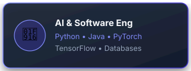

<div align="center">

  <!-- Computer Header Image with Glowing Text Background & Terminal Display -->
  

  <br/><br/>

  <!-- Animated Typing Subtitle -->
  <a href="https://git.io/typing-svg">
    
  </a>

  <br/><br/>

  <!-- Quick Badges -->
  <a href="https://www.linkedin.com/in/heloisa-pgarcia" target="_blank">
    
  </a>
  <a href="mailto:heloisa.design.99freelas@gmail.com">
    
  </a>
  
  

</div>

<br/>

---

## ⚡ `whoami`

```bash
$ whoami --verbose
> Name: Heloisa Pe Garcia
> Location: São Paulo, SP - Brazil 🇧🇷
> Role: Software Developer | DevOps & Cloud Architect | AI Enthusiast
> Status: 🚀 Building resilient cloud infrastructure & intelligent software solutions
> Philosophy: "Transforming complex engineering challenges into scalable, elegant systems."
```

<br/>

<!-- Visual Domain Cards -->
<div align="center">
  <table border="0" width="100%">
    <tr align="center">
      <td width="33%">
        
      </td>
      <td width="33%">
        
      </td>
      <td width="33%">
        
      </td>
    </tr>
  </table>
</div>

<br/>

<table align="center" width="100%">
  <tr>
    <td width="50%" valign="top">
      <h3>🚀 Core Pillars</h3>
      <ul>
        <li>⚡ <b>DevOps & Infrastructure:</b> CI/CD pipelines, containerization, automation & GitOps practices.</li>
        <li>☁️ <b>Cloud Architecture:</b> Designing scalable AWS & Azure environments with Terraform IaC.</li>
        <li>🤖 <b>Artificial Intelligence:</b> Machine learning algorithms, Python, and data integration.</li>
        <li>🖨️ <b>Physical Computing & Maker:</b> 3D CAD modeling, 3D printing & hardware prototyping.</li>
      </ul>
    </td>
    <td width="50%" valign="top">
      <h3>🌱 Current Focus & Journey</h3>
      <ul>
        <li>📦 Advanced orchestration with <b>Kubernetes</b> & Service Meshes.</li>
        <li>🔄 Building automated <b>GitOps & MLOps</b> workflows.</li>
        <li>🧠 Exploring AI Agents, LLM integration & autonomous systems.</li>
        <li>💡 Continuously building, experimenting & contributing to open source.</li>
      </ul>
    </td>
  </tr>
</table>

<br/>

---

## 🛠️ Tech Stack & Ecosystem

<div align="center">

  <h3>💻 Languages & Core Web</h3>
  <a href="https://skillicons.dev">
    
  </a>

  <br/><br/>

  <h3>☁️ Cloud, DevOps & Infrastructure</h3>
  <a href="https://skillicons.dev">
    
  </a>

  <br/><br/>

  <h3>🛢️ Databases, AI & Development Tools</h3>
  <a href="https://skillicons.dev">
    
  </a>

</div>

<br/>

---

## 📊 Activity & GitHub Metrics

<div align="center">

  <table border="0">
    <tr>
      <td>
        <a href="https://github.com/HeloisaPeGarcia">
          
        </a>
      </td>
      <td>
        <a href="https://github.com/HeloisaPeGarcia">
          
        </a>
      </td>
    </tr>
  </table>

  <br/>

  

  <br/><br/>

  

</div>

<br/>

---

## 💬 Get In Touch

<div align="center">
  <p>Interested in collaborating, discussing Cloud/DevOps architecture, or sharing cool 3D printing projects?</p>

  <a href="https://www.linkedin.com/in/heloisa-pgarcia" target="_blank">
    
  </a>
  &nbsp;&nbsp;
  <a href="mailto:heloisa.design.99freelas@gmail.com">
    
  </a>

  <br/><br/>

  

  <br/><br/>

  
</div>
